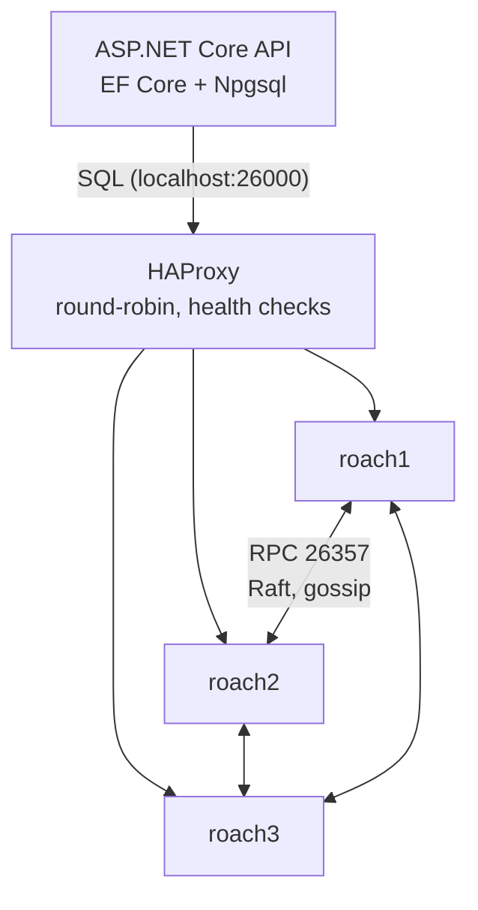
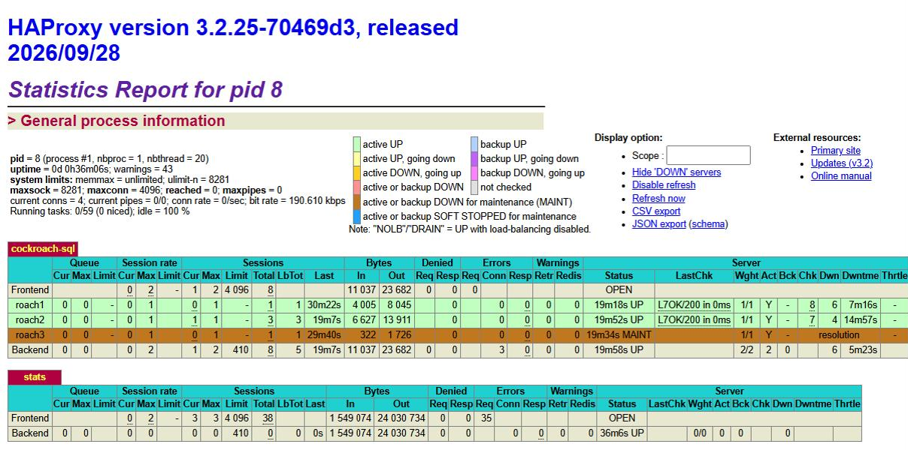
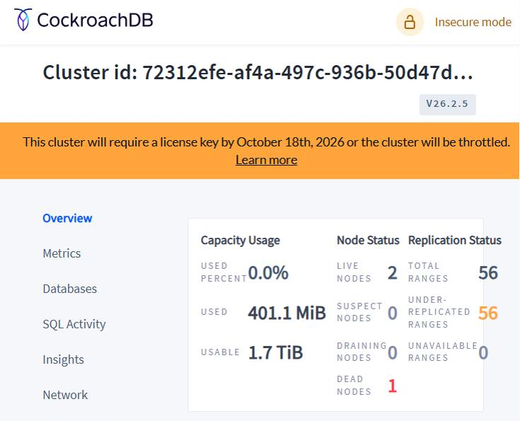

# CockroachDB .NET Lab

A small lab I built to learn how a distributed SQL database actually behaves: a 3-node CockroachDB cluster in Docker, HAProxy in front of it, and a minimal ASP.NET Core API on top.

The app is intentionally simple (customers and their transactions). The interesting part is the infrastructure: how the nodes form a cluster, how data is split and replicated, what happens when nodes go down, and what had to change in EF Core to make it work with CockroachDB.

What I learned along the way is written up in [docs/lessons.md](docs/lessons.md).

## Architecture



| Port (host) | What |
|---|---|
| 26000 | SQL through HAProxy (the app uses this) |
| 26257 / 26258 / 26259 | SQL directly to roach1 / roach2 / roach3 |
| 8080 / 8081 / 8082 | CockroachDB console on each node |
| 8404 | HAProxy stats page |
| 5080 | API + Swagger UI (`/swagger`) |

## Stack

- CockroachDB v26.2.5, 3 nodes, insecure mode (lab only)
- HAProxy 3.2
- .NET 10, ASP.NET Core minimal APIs with Carter, Swagger
- EF Core 10 with `Npgsql.EntityFrameworkCore.PostgreSQL` 10.0.3

## Running it

```powershell
# 1. start the three nodes and HAProxy
docker compose up -d

# 2. first time only: create the cluster
docker exec -it roach1 ./cockroach init --insecure --host=roach1:26357
docker exec -it roach1 ./cockroach sql --insecure --host=roach1:26257 -e "CREATE DATABASE IF NOT EXISTS bank;"

# 3. run the API (migrations are applied on startup)
dotnet run --project src/CrdbLab.Api
```

Then open http://localhost:5080/swagger. `GET /db/node` tells you which CockroachDB node handled the query.

## Screenshots

HAProxy with `roach3` stopped: it is taken out of rotation and traffic keeps going to the other two nodes.



CockroachDB console with one node dead: every range is under-replicated (2 of 3 copies), but **0 unavailable ranges**, so reads and writes still work.



## Project layout

```
docker-compose.yml          3 CockroachDB nodes + HAProxy
haproxy/haproxy.cfg         SQL load balancing, health checks, Docker DNS resolver
src/CrdbLab.Api/
  Program.cs                startup only
  Endpoints/                Carter modules (customers, transactions, /db/node)
  Data/                     DbContext + CockroachDB-specific migration fixes
  Models/, Contracts.cs     entities and request/response records
  Migrations/               EF Core migrations
```

## CockroachDB-specific bits in the code

- `Data/CockroachHistoryRepository.cs`: EF Core locks the migrations table with `LOCK TABLE`, which CockroachDB doesn't support. This replaces the lock with a no-op.
- `Data/CockroachMigrationsSqlGenerator.cs`: CockroachDB commits an open transaction before running DDL (`autocommit_before_ddl`), which breaks EF's "one migration = one transaction". Migration statements now run one by one.
- Primary keys are UUIDs generated by the database (`gen_random_uuid()`), so inserts spread across ranges instead of piling onto the last one.

## Not production

Everything runs on one machine in insecure mode. Three containers on one laptop don't give real high availability. See the last section of [docs/lessons.md](docs/lessons.md) for what would change.
